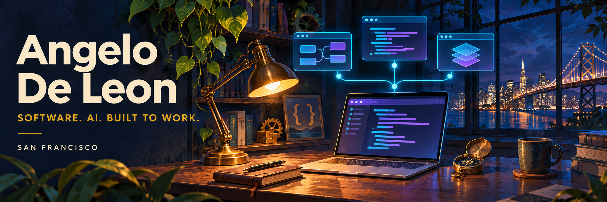
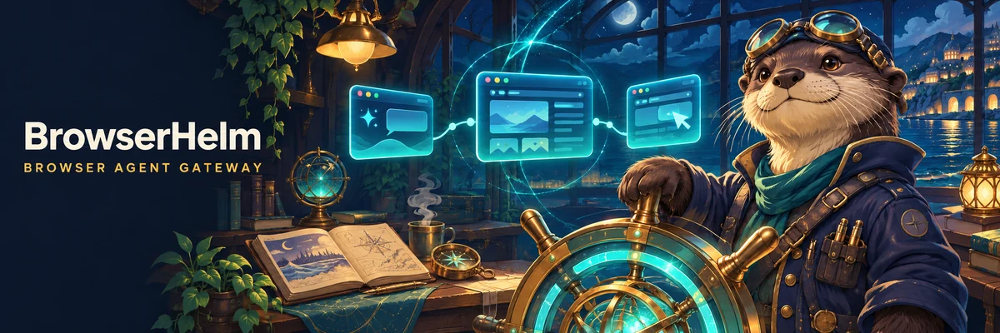
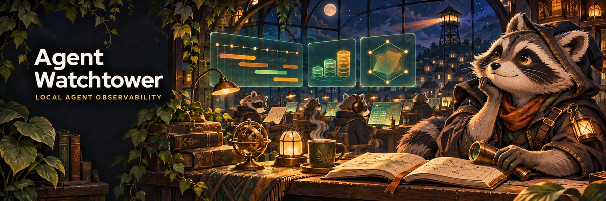
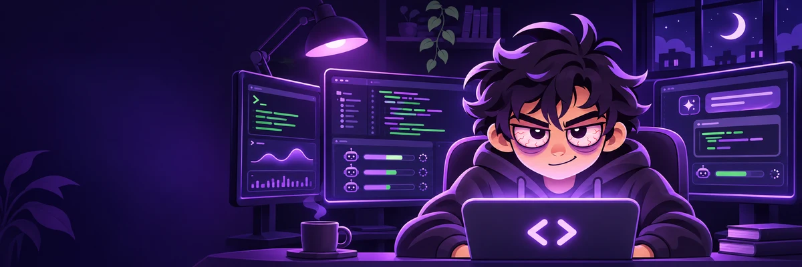
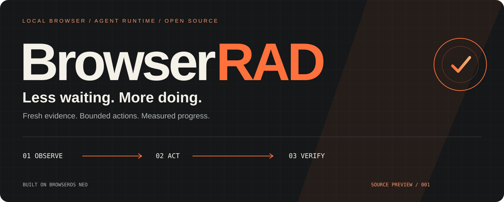
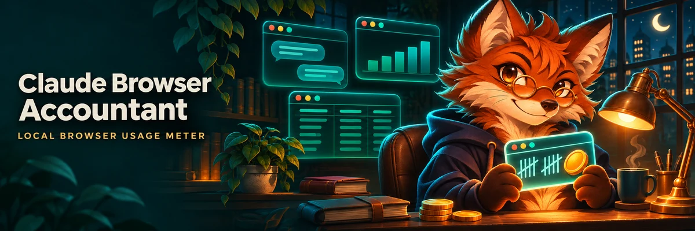
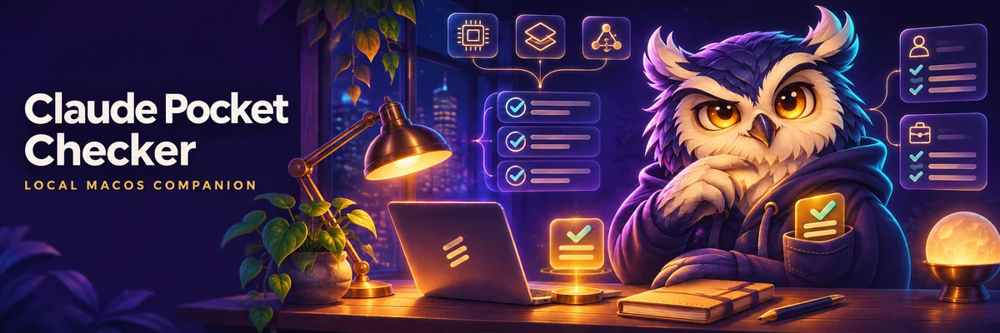
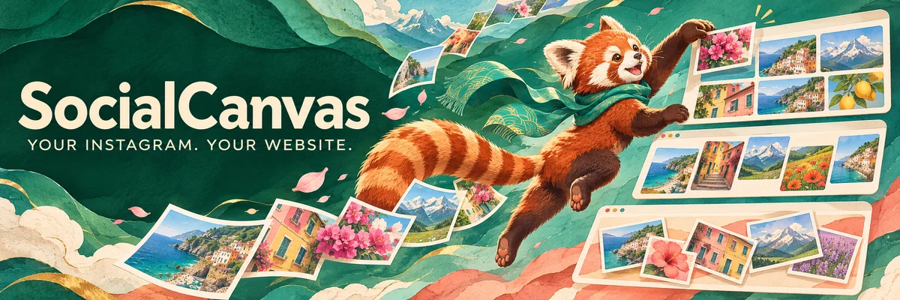

<h1 align="center">Angelo De Leon</h1>

<strong>Head of AI at TechInSF · Applied AI Engineer · San Francisco</strong>

I turn messy workflows into useful software, connected agents, and tools people can actually run.

<a href="#what-i-work-on">My work</a> · <a href="#featured-projects">Projects</a> · <a href="#more-tools-and-configurations">More tools</a> · <a href="#the-toolbox">Stack</a> · <a href="#github-in-motion">Activity</a> · <a href="#from-the-build-log">Writing</a>

## What I work on

I lead AI work at [TechInSF](https://techinsf.com/) and build across the whole delivery path: discovery, application development, integrations, infrastructure, and helping a team use what ships. My work includes full-stack web apps, API and webhook automation, MCP integrations, browser agents, and local/private model deployments.

The projects below come from problems I run into myself: browser context that gets in the way, agent activity scattered across tools, a Mac that sleeps halfway through a remote session, or a model choice that deserves a second look.

**15+ years in IT · 1,000+ clients served · Coding since 2014 · Shipping LLM systems since 2022**

| Where I contribute | What that looks like |
| --- | --- |
| **Applied AI & agents** | MCP boundaries, browser execution, model routing, local inference, and evidence that a task actually finished. |
| **Product engineering** | Native macOS tools, full-stack web applications, integrations, and practical interfaces for everyday workflows. |
| **Delivery & enablement** | Docker/VPS deployments, operational documentation, team training, and taking a prototype toward a maintainable system. |

[Engineering case studies](https://angelodeleon.com/projects/) · [Client and internal delivery](https://angelodeleon.com/work/) · [Experience](https://angelodeleon.com/resume/)

## Featured projects

<table>
<tr>
<td width="50%" valign="top">

<h3><a href="https://github.com/RaDeleon/BrowserHelm">BrowserHelm</a></h3>

A native macOS MCP gateway between assistants and browser agents. Compact context, optional model routing, and verified experience reuse.

<code>SwiftUI</code> <code>Python</code> <code>MCP</code> <code>SQLite</code>

<a href="https://github.com/RaDeleon/BrowserHelm/releases">Download</a> · <a href="https://angelodeleon.com/projects/browserhelm/">Case study</a>

</td>
<td width="50%" valign="top">

<h3><a href="https://github.com/RaDeleon/Agent-Watchtower">Agent Watchtower</a></h3>

Local observability for Claude Code, Codex, and Hermes: activity, tokens, API-price estimates, and a character sheet built from observed history.

<code>TypeScript</code> <code>Node.js</code> <code>SQLite</code>

<a href="https://github.com/RaDeleon/Agent-Watchtower#quick-start">Get started</a> · <a href="https://angelodeleon.com/projects/agent-watchtower/">Case study</a>

</td>
</tr>
<tr>
<td width="50%" valign="top">

<h3><a href="https://github.com/RaDeleon/Vibesomnia">Vibesomnia</a></h3>

Keep a Mac and its AI workspace awake during remote work. Native sessions, app-aware behavior, and an optional closed-lid guard.

<code>Swift</code> <code>SwiftUI</code> <code>IOKit</code>

<a href="https://github.com/RaDeleon/Vibesomnia/releases">Download</a> · <a href="https://angelodeleon.com/projects/vibesomnia/">Case study</a>

</td>
<td width="50%" valign="top">

<h3><a href="https://github.com/RaDeleon/BrowserOS/tree/codex/browserrad">BrowserRAD</a></h3>

My independent BrowserOS Neo fork: scoped browser evidence, bounded actions, and a separate app/profile. Built on BrowserOS and Chromium.

<code>Chromium</code> <code>Rust</code> <code>TypeScript</code> <code>MCP</code>

<a href="https://github.com/RaDeleon/BrowserOS/tree/codex/browserrad">Fork source</a> · <a href="https://angelodeleon.com/projects/browserrad/">Case study</a>

</td>
</tr>
<tr>
<td width="50%" valign="top">

<h3><a href="https://github.com/RaDeleon/Claude-Browser-Accountant">Claude Browser Accountant</a></h3>

A local Claude.ai extension for visible-text token estimates, API-equivalent prices, and rounded plan readings. Separate personal/work ledgers.

<code>JavaScript</code> <code>Manifest V3</code> <code>DOM</code>

<a href="https://github.com/RaDeleon/Claude-Browser-Accountant/releases">Download</a> · <a href="https://angelodeleon.com/projects/claude-browser-accountant/">Case study</a>

</td>
<td width="50%" valign="top">

<h3><a href="https://github.com/RaDeleon/Claude-Pocket-Checker">Claude Pocket Checker</a></h3>

A separate macOS companion for regular Claude Desktop Chat: local estimates and before-send model/effort advice. Official Claude stays intact.

<code>SwiftUI</code> <code>AppKit</code> <code>Accessibility</code>

<a href="https://github.com/RaDeleon/Claude-Pocket-Checker/releases/tag/v0.2.2">Download the Mac app</a> · <a href="https://angelodeleon.com/projects/claude-pocket-checker/">Case study</a>

</td>
</tr>
</table>

### Also building for the web

**[SocialCanvas](https://github.com/RaDeleon/SocialCanvas)** — an open-source Instagram widget platform with a dashboard and multiple display layouts. **TypeScript · React · Node.js.** [Read the case study ↗](https://angelodeleon.com/projects/socialcanvas/)

These are independent projects at different stages of development. Release pages and validation notes describe current requirements and limitations. API-equivalent estimates are not subscription bills; performance experiments are workload-specific evidence.

## More tools and configurations

| Repository | Focus |
| --- | --- |
| [Overkill AI Check](https://github.com/RaDeleon/Overkill-AI) | A lightweight browser tool exploring Claude model/effort choices and plan-use comparisons. |
| [Code-Cordon](https://github.com/RaDeleon/Code-Cordon) | Local-first analysis of repositories and AI-agent assets before use. |
| [Rune-Forge](https://github.com/RaDeleon/Rune-Forge) | macOS/Ubuntu setup tools and a curated system, AI, development, and security toolbox. |
| [Claude Code Ultimate Setup](https://github.com/RaDeleon/Claude-Code-Ultimate-Setup) | A shareable Claude Code configuration with a custom status line and mods. |
| [Build Beautiful Sites](https://github.com/RaDeleon/Build-Beautiful-Sites) | A reusable skill for building websites with coding agents. |
| [Angelo Claude SEO](https://github.com/RaDeleon/Angelo-Claude-SEO) | My public Claude Code SEO skill repository: technical SEO, schema, content, and AI-search visibility. |

[Browse every public repository ↗](https://github.com/RaDeleon?tab=repositories&type=public)

## The toolbox

 

## GitHub in motion

<picture>
<source media="(prefers-color-scheme: dark)" srcset="assets/generated/snake-dark.svg" />

</picture>

Cards and animation are generated daily and stored in this repository. Public GitHub data only; language volume and contribution counts are context, not a measure of engineering impact. <a href="docs/WIDGETS.md">Widget sources and refresh details</a>.

## From the build log

I write about implementation decisions, measurement limits, and what I learned while building.

<!-- writing:start -->
- [Claude Pocket Checker: checking the model before sending the prompt](https://angelodeleon.com/writing/checking-the-model-before-sending-the-prompt/)
- [Claude Browser Accountant: counting what the browser can actually see](https://angelodeleon.com/writing/counting-claude-without-inventing-the-bill/)
- [BrowserAI DUO beyond the browser: one agent for the whole job](https://angelodeleon.com/writing/browserai-duo-beyond-the-browser/)
- [Why I Built Overkill AI Check](https://angelodeleon.com/writing/why-i-built-overkill-ai-check/)
- [Vibesomnia: keeping the AI night shift awake](https://angelodeleon.com/writing/keeping-the-ai-night-shift-awake/)
<!-- writing:end -->

[All writing](https://angelodeleon.com/writing/) · [RSS](https://angelodeleon.com/rss.xml)

---

<strong>Have a real workflow that could work better?</strong> 
<a href="https://angelodeleon.com/contact/">Let's talk about it.</a> · <a href="https://www.linkedin.com/in/angelo-deleon">Connect on LinkedIn</a>

